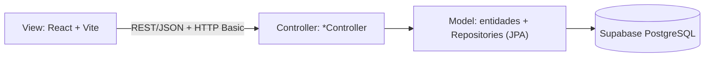
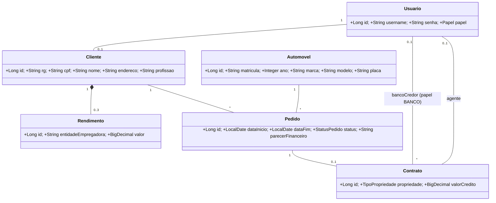
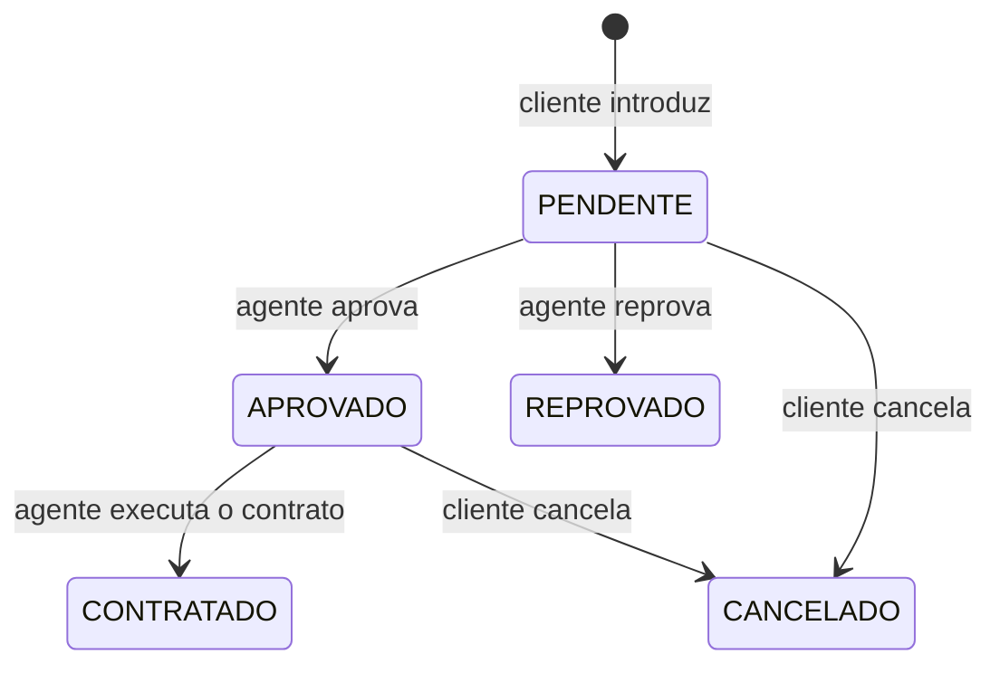
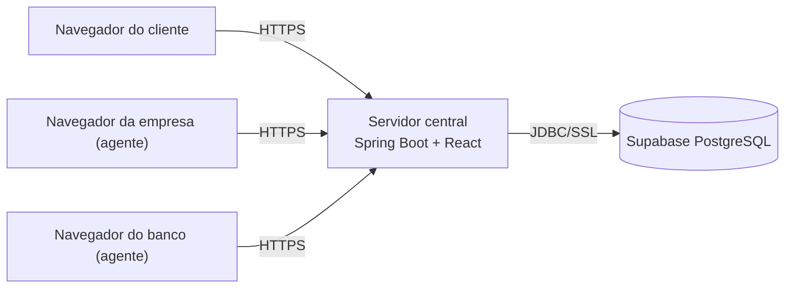
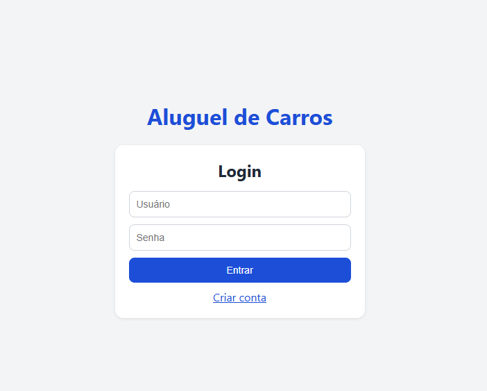
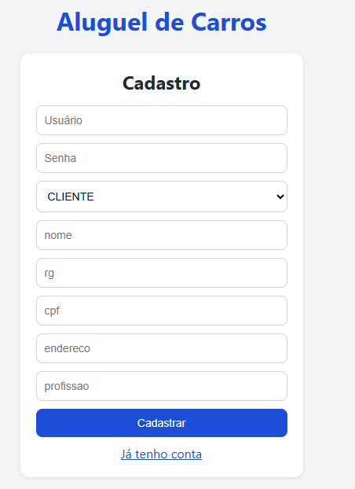
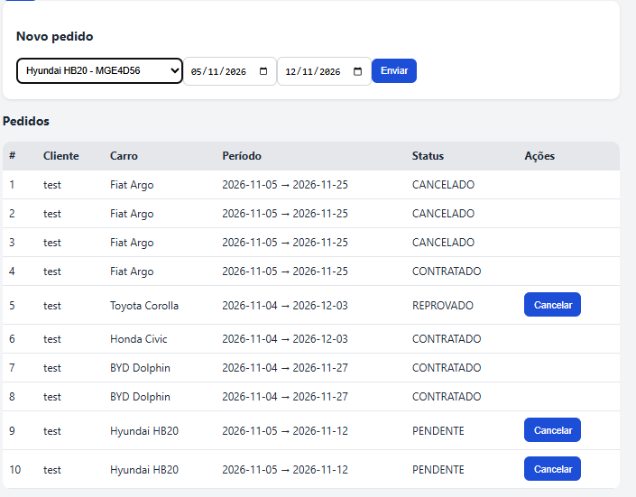
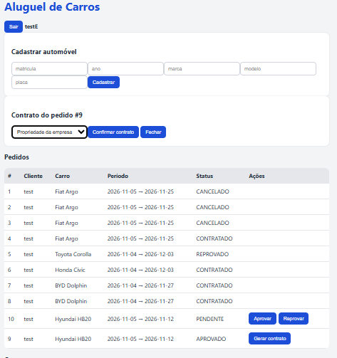
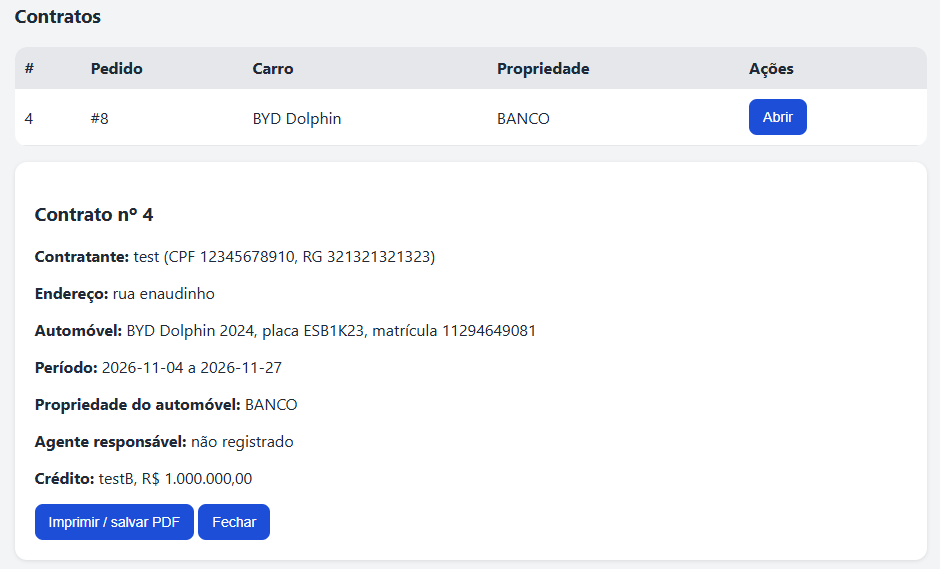

<!-- Sistema de Aluguel de Carros - Laboratório 2 de DIAW, PUC Minas -->

---

# 🚗 Sistema de Aluguel de Carros 👨‍💻

> [!NOTE]
> Sistema web para **gestão de aluguéis de automóveis**: clientes fazem, modificam e cancelam pedidos pela Internet, e agentes (empresas e bancos) avaliam os pedidos e formalizam o contrato, com ou sem crédito bancário.

<table>
  <tr>
    <td width="800px">
      <div align="justify">
        Projeto desenvolvido no <b>Laboratório de Desenvolvimento de Software</b> (Engenharia de Software, PUC Minas). O sistema só pode ser usado após <b>cadastro e login</b> e organiza o ciclo completo de um aluguel: <i>pedido</i> do cliente, <i>análise financeira</i> pelo agente e <i>contrato</i>, que pode ser aberto por todos os participantes. Foi construído com <b>Spring Boot</b> (arquitetura MVC) no back-end, <b>React + Vite</b> no front-end e <b>Supabase (PostgreSQL)</b> como banco de dados.
      </div>
    </td>
    <td>
      <div align="center" style="font-size:80px">🚗</div>
    </td>
  </tr>
</table>

---

## 🚧 Status do Projeto


---

## 📚 Índice
- [Links Úteis](#-links-úteis)
- [Sobre o Projeto](#-sobre-o-projeto)
- [Funcionalidades Principais](#-funcionalidades-principais)
- [Tecnologias Utilizadas](#-tecnologias-utilizadas)
- [Arquitetura](#-arquitetura)
- [Instalação e Execução](#-instalação-e-execução)
- [API REST](#-api-rest)
- [Deploy](#-deploy)
- [Estrutura de Pastas](#-estrutura-de-pastas)
- [Demonstração](#-demonstração)
- [Testes](#-testes)
- [Documentações utilizadas](#-documentações-utilizadas)
- [Autores](#-autores)
- [Licença](#-licença)

---

## 🔗 Links Úteis
* 📖 **Modelos UML (classes, arquitetura, implantação):** [`docs/modelos.md`](./docs/modelos.md)
* 💾 **Script do banco de dados:** [`docs/schema.sql`](./docs/schema.sql)
* 🌐 **Demo Online:** _não publicada; o sistema roda localmente (veja [Instalação e Execução](#-instalação-e-execução))._

---

## 📝 Sobre o Projeto

**Problema que resolve:** a gestão de aluguéis de automóveis feita sem sistema depende de trocas manuais entre cliente, empresa e banco. Este projeto centraliza o pedido, a análise financeira e a formalização do contrato em um único servidor acessível pela Internet.

**Como funciona, em resumo:**
- O cliente cadastra seus dados de identificação (RG, CPF, nome, endereço), profissão e até **3 rendimentos** (entidade empregadora e valor).
- O cliente **introduz, modifica, consulta e cancela** pedidos de aluguel.
- Os **agentes** (empresas e bancos) **modificam e avaliam** os pedidos. Com parecer financeiro positivo, o pedido é aprovado e o agente **executa o contrato**.
- No contrato, o automóvel pode ficar registrado como **propriedade do cliente, da empresa ou do banco**, e o aluguel pode estar associado a um **contrato de crédito concedido por um banco**.
- Os participantes do contrato (cliente, agente responsável e banco credor) podem **abri-lo** e imprimi-lo.

**Contexto:** projeto acadêmico. O sistema é dividido em dois subsistemas: *gestão de pedidos e contratos* (back-end) e *construção dinâmica das páginas web* (front-end).

---

## ✨ Funcionalidades Principais

- 🔐 **Autenticação:** cadastro e login obrigatórios (usuário e senha, com senha criptografada em BCrypt) e três papéis: `CLIENTE`, `EMPRESA` e `BANCO`.
- 📝 **Pedidos de aluguel:** o cliente cria, consulta, modifica (enquanto pendente) e cancela.
- ✅ **Avaliação financeira:** o agente aprova ou reprova pedidos pendentes, com parecer.
- 📄 **Contratos:** gerados a partir de pedidos aprovados, com escolha da propriedade do automóvel e, para bancos, crédito com valor.
- 🔎 **Abertura do contrato pelos participantes:** cada participante vê só os contratos de que faz parte, e pode imprimir ou salvar em PDF.
- 🚘 **Automóveis:** cadastro (matrícula, ano, marca, modelo e placa) feito pelos agentes.
- 🛡️ **Controle de acesso por papel:** ações restritas a clientes ou a agentes, validadas no back-end.

---

## 🛠 Tecnologias Utilizadas

### 💻 Front-end
* **Biblioteca:** React 19
* **Linguagem:** JavaScript (ES6+)
* **Build Tool:** Vite 7 (com proxy de `/api` para o back-end)
* **Estilização:** CSS puro

### 🖥️ Back-end
* **Linguagem:** Java 25 (JDK 25)
* **Framework:** Spring Boot 4.0.x (Spring MVC, Spring Data JPA, Spring Security, Bean Validation)
* **Build e dependências:** Apache Maven
* **ORM:** Hibernate/JPA
* **Autenticação:** HTTP Basic com Spring Security e BCrypt

### ⚙️ Infraestrutura
* **Banco de dados:** Supabase (PostgreSQL)
* **Versionamento:** Git e GitHub

---

## 🏗 Arquitetura

O back-end segue o padrão **MVC** e o front-end consome a API REST:



| Camada | Pasta | Responsabilidade |
| :--- | :--- | :--- |
| **View** | `frontend/src` | Telas de login, cadastro, pedidos e contratos |
| **Controller** | `backend/.../controller` | Endpoints REST, regras do fluxo e verificação de permissões |
| **Model** | `backend/.../model` | Entidades JPA e enums do domínio |
| **Repository** | `backend/.../repository` | Acesso ao banco com Spring Data JPA |
| **Config** | `backend/.../config` | Segurança (Spring Security, BCrypt) |

### Diagrama de classes



### Fluxo do pedido



### Diagrama de implantação



Os diagramas ficam versionados em [`docs/modelos.md`](./docs/modelos.md).

### Requisitos x implementação

| Requisito | Onde está |
| :--- | :--- |
| Login obrigatório com usuário e senha | `SecurityConfig`, `AuthController` |
| Cliente introduz, modifica, consulta e cancela pedidos | `PedidoController` |
| Agentes modificam e avaliam pedidos | `PedidoController` (`/avaliar`) |
| Dados do contratante e até 3 rendimentos | `Cliente`, `Rendimento` (`@Size(max = 3)` e gatilho no banco) |
| Propriedade do automóvel: cliente, empresa ou banco | `Contrato.propriedade` |
| Dados do automóvel | `Automovel` |
| Contrato de crédito concedido por banco | `Contrato.bancoCredor` e `valorCredito` |
| Servidor central ligado a clientes e agentes pela Internet | API REST + diagrama de implantação |

---

## 🔧 Instalação e Execução

### Pré-requisitos
* **Java JDK 25**
* **Apache Maven 3.9+**
* **Node.js** LTS (v18 ou superior) e npm
* Um projeto no **Supabase** (plano gratuito serve)

### 💾 Banco de dados (Supabase)

1. Crie um projeto no [Supabase](https://supabase.com).
2. Abra o **SQL Editor**, cole o conteúdo de [`docs/schema.sql`](./docs/schema.sql) e execute. Ele cria as tabelas e insere alguns automóveis de exemplo.
3. Em **Connect**, copie o host, a porta e o usuário da conexão do banco. Se a rede só tiver IPv4, use o **Session pooler**.

### 🔑 Variáveis de Ambiente

Crie o arquivo `backend/.env` (ele **não** é versionado) com **três linhas, sem aspas**:

```dotenv
SUPABASE_DB_URL=jdbc:postgresql://HOST:5432/postgres?sslmode=require
SUPABASE_DB_USER=postgres
SUPABASE_DB_PASSWORD=sua_senha
```

| Variável | Descrição | Exemplo |
| :--- | :--- | :--- |
| `SUPABASE_DB_URL` | URL JDBC do banco | `jdbc:postgresql://db.<ref>.supabase.co:5432/postgres?sslmode=require` |
| `SUPABASE_DB_USER` | Usuário do banco | `postgres` (no Session pooler: `postgres.<ref>`) |
| `SUPABASE_DB_PASSWORD` | Senha do banco | definida no projeto Supabase |

O Spring importa esse arquivo pela linha `spring.config.import=optional:file:.env[.properties]` do `application.properties`. Há um modelo em `backend/.env.example`.

### 📦 Instalação

```bash
git clone https://github.com/AlexandreSampaioGuimaraesRibeiro/Sistema_de_Aluguel_de_Carros.git
cd Sistema_de_Aluguel_de_Carros

# Front-end
cd frontend
npm install
cd ..
```

### ⚡ Como Executar
Use **dois terminais**.

**Terminal 1: Back-end** (rode de dentro da pasta `backend`, onde está o `.env`)
```bash
cd backend
mvn spring-boot:run
```
🚀 *Disponível em **http://localhost:8080**.*

**Terminal 2: Front-end**
```bash
cd frontend
npm run dev
```
🎨 *Disponível em **http://localhost:5173**. O Vite redireciona `/api` para o back-end.*

### 🧭 Roteiro de uso

1. Crie uma conta **EMPRESA** ou **BANCO** (tela *Criar conta*) e outra **CLIENTE**, com os dados de identificação.
2. Como agente, cadastre automóveis em **Cadastrar automóvel**, se quiser além dos de exemplo.
3. Como cliente, abra um **Novo pedido** escolhendo o automóvel e o período.
4. Como agente, **aprove** o pedido e use **Gerar contrato**, escolhendo a propriedade do automóvel. Contas `BANCO` podem incluir crédito e valor.
5. Cliente e agente abrem o contrato na lista **Contratos** pelo botão **Abrir**.

---

## 🌐 API REST

Todas as rotas usam o prefixo `/api` e exigem autenticação (HTTP Basic), exceto o cadastro.

| Método | Rota | Quem acessa | Descrição |
| :--- | :--- | :--- | :--- |
| `POST` | `/auth/register` | Público | Cadastra usuário (e cliente, se o papel for `CLIENTE`) |
| `GET` | `/auth/me` | Autenticado | Usuário e papéis da sessão |
| `GET` | `/automoveis` | Autenticado | Lista automóveis |
| `POST` | `/automoveis` | Agentes | Cadastra automóvel |
| `GET` | `/pedidos` | Autenticado | Cliente vê os seus; agentes veem todos |
| `POST` | `/pedidos` | Cliente | Introduz pedido |
| `PUT` | `/pedidos/{id}` | Dono ou agente | Modifica pedido `PENDENTE` |
| `DELETE` | `/pedidos/{id}` | Cliente | Cancela pedido |
| `PUT` | `/pedidos/{id}/avaliar` | Agentes | Aprova ou reprova |
| `GET` | `/contratos` | Participante | Lista os contratos de que participa |
| `GET` | `/contratos/{id}` | Participante | Abre um contrato |
| `POST` | `/contratos` | Agentes | Executa contrato de pedido aprovado (crédito só para banco) |

---

## 🚀 Deploy

O projeto ainda não está hospedado. Para gerar os artefatos de produção:

```bash
# Front-end: arquivos estáticos em frontend/dist
cd frontend && npm run build

# Back-end: JAR executável em backend/target
cd ../backend && mvn clean package
java -jar target/aluguel-carros-1.0.0.jar
```

Em produção, defina `SUPABASE_DB_URL`, `SUPABASE_DB_USER` e `SUPABASE_DB_PASSWORD` como variáveis de ambiente do provedor e sirva o `dist` do front-end com a rota `/api` apontando para o back-end.

---

## 📂 Estrutura de Pastas

```
.
├── .gitignore
├── README.md
├── /docs
│   ├── modelos.md               # 📐 Diagramas UML (classes, arquitetura, implantação)
│   └── schema.sql               # 💾 Script do banco de dados
│
├── /backend                     # ☕ Spring Boot (MVC)
│   ├── .env.example             # 🧩 Modelo das variáveis de ambiente
│   ├── pom.xml
│   └── /src/main
│       ├── /java/com/aluguel
│       │   ├── AluguelApplication.java
│       │   ├── /config          # 🔧 SecurityConfig
│       │   ├── /controller      # 🎮 Auth, Automovel, Pedido, Contrato
│       │   ├── /model           # 🧬 Entidades e enums
│       │   └── /repository      # 🗄️ Repositórios Spring Data JPA
│       └── /resources
│           └── application.properties
│
└── /frontend                    # ⚛️ React + Vite
    ├── index.html
    ├── package.json
    ├── vite.config.js
    └── /src
        ├── main.jsx
        ├── App.jsx              # 🖥️ Login, cadastro, pedidos e contratos
        ├── api.js               # 🔌 Chamadas HTTP com autenticação
        └── index.css
```

---

## 🎥 Demonstração

> Adicione aqui capturas de tela e GIFs do sistema (por exemplo em `docs/img/`).

| Tela | Captura de Tela |
| :---: | :---: |
| **Login e cadastro** |  |
| **Pedidos do cliente** |  |
| **Avaliação pelo agente** |  |
| **Contrato aberto** |  |

---

## 🧪 Testes

Ainda não há testes automatizados. A validação foi feita manualmente, percorrendo o fluxo completo: cadastro, login, pedido, aprovação, contrato e abertura pelos participantes.

---

## 🔗 Documentações utilizadas

* 📖 [Spring Boot](https://docs.spring.io/spring-boot/index.html)
* 📖 [Spring Security](https://docs.spring.io/spring-security/reference/)
* 📖 [Spring Data JPA](https://docs.spring.io/spring-data/jpa/reference/)
* 📖 [React](https://react.dev/reference/react)
* 📖 [Vite](https://vitejs.dev/config/)
* 📖 [Supabase Database](https://supabase.com/docs/guides/database)
* 📖 [Conventional Commits](https://www.conventionalcommits.org/en/v1.0.0/)

---

## 👥 Autores

| 👤 Nome | :octocat: GitHub | 💼 LinkedIn |
|---------|-----------------|-------------|
| Alexandre Sampaio Guimarães Ribeiro | [AlexandreSampaioGuimaraesRibeiro](https://github.com/AlexandreSampaioGuimaraesRibeiro) | [Perfil](https://www.linkedin.com/in/alexandre-sampaio-guimarães-ribeiro-417760410) |


---

## 📄 Licença

Projeto acadêmico da **Engenharia de Software — PUC Minas**, distribuído sob a **Licença MIT**.

---