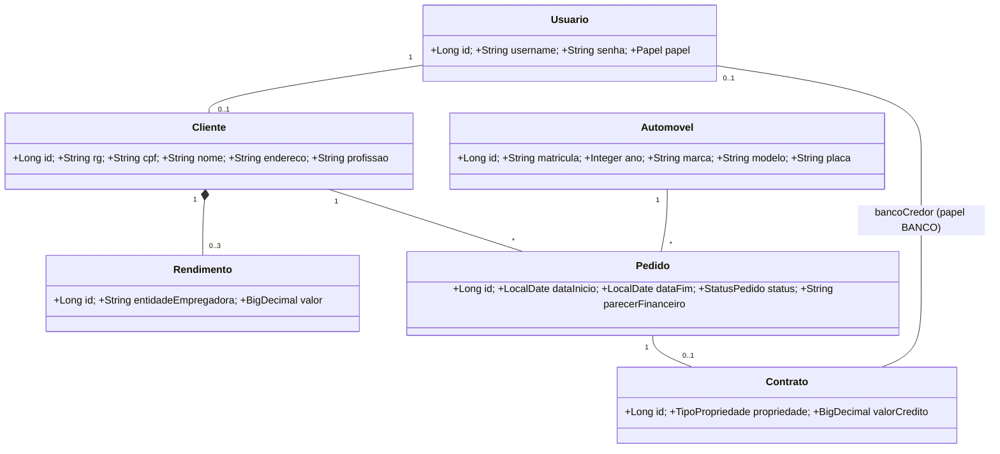
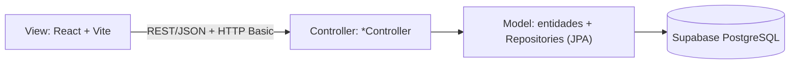
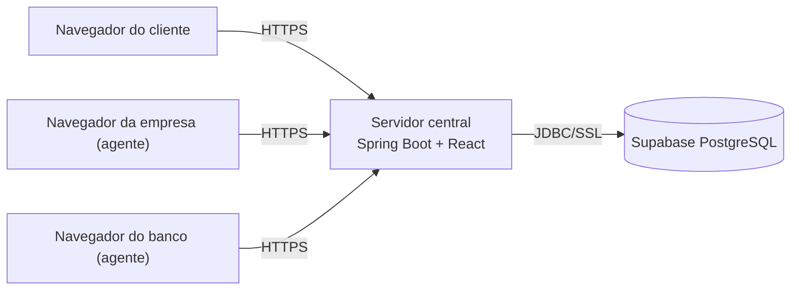

# Modelos UML (versão 1)

## Diagrama de classes

## Arquitetura (MVC)

Subsistemas: (1) gestão de pedidos e contratos = back-end Spring Boot; (2) construção dinâmica das páginas = front-end React.

## Fluxo do pedido
PENDENTE → (agente avalia) APROVADO | REPROVADO → (agente executa contrato) CONTRATADO. O cliente pode cancelar até CONTRATADO.

## Diagrama de implantação

Clientes e agentes acessam o servidor central pela Internet. A propriedade do automóvel e o crédito bancário ficam registrados no **contrato**.